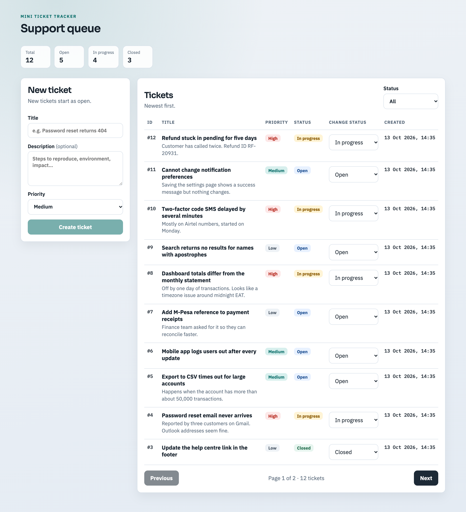
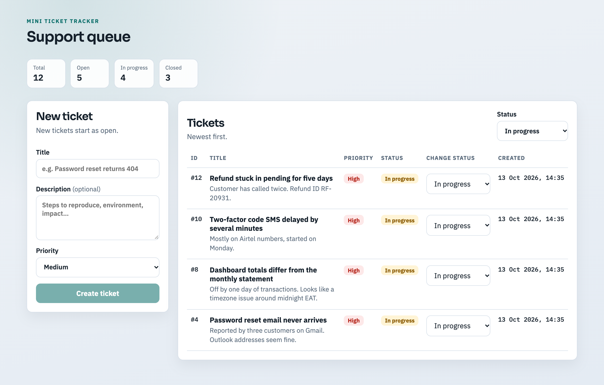
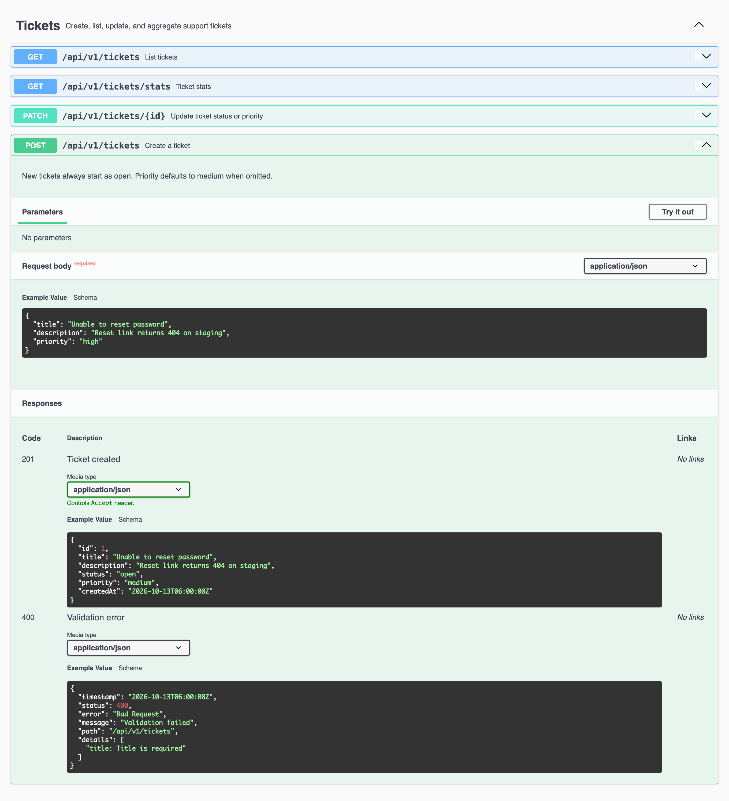

# Mini Ticket Tracker

A small support ticket tracker. The backend is a Spring Boot REST API on PostgreSQL, and the UI is a single React page that talks to it.

I built this as a take-home exercise. The brief asked for judgment over feature count, so I kept the scope to what was asked and spent the time on structure, validation and tests instead.

Harrison Kiprono



## What's in it

- Java 25, Spring Boot 4, Spring Data JPA
- Lombok for getters, constructors and the logger
- PostgreSQL 16, with Flyway for the schema
- Swagger UI for the API docs (springdoc)
- React 19 + TypeScript, built with Vite
- Integration tests with JUnit, MockMvc and Testcontainers

## What you need installed

- Docker. It runs Postgres, and the tests use it too.
- Node.js 20 or newer.
- Any recent JDK, just to start Gradle. You don't have to install Java 25 yourself. If Gradle can't find it, it downloads it on the first build.

You don't need Gradle installed either, the wrapper (`./gradlew`) is in the repo.

## Running it locally

Three terminals, in this order.

**1. Start the database**

```bash
docker compose up -d
```

This gives you Postgres on `localhost:5432` with a database called `ticket_tracker` (user `ticket`, password `ticket`). You don't have to create any tables. Flyway does that when the backend starts.

**2. Start the backend**

```bash
cd backend
./gradlew bootRun
```

The first run takes a while because it downloads dependencies. Once it's up:

- API: http://localhost:8080/api/v1
- Swagger UI: http://localhost:8080/swagger-ui.html
- Health check: http://localhost:8080/actuator/health

**3. Start the frontend**

```bash
cd frontend
cp .env.example .env
npm install
npm run dev
```

Then open http://localhost:5173.

## Screenshots

The whole UI is one page, shown at the top of this README: the counts per status, the form on the left, and the ticket list with a status dropdown on every row.

Filtering the list by status:



The API documented in Swagger UI, with the create endpoint opened:



## Building it

If you want the build artifacts rather than the dev servers:

**Backend**

```bash
cd backend
./gradlew build
```

This compiles the code, runs the tests and produces a runnable jar at `build/libs/ticket-tracker-0.0.1-SNAPSHOT.jar`. Docker has to be running because of the tests. To build without them:

```bash
./gradlew build -x test
```

Run the jar with the database up:

```bash
java -jar build/libs/ticket-tracker-0.0.1-SNAPSHOT.jar
```

**Frontend**

```bash
cd frontend
npm install
npm run build
```

This type-checks the project and writes the production bundle to `frontend/dist`. `npm run preview` serves that bundle locally if you want to check it, and `npm run lint` runs the linter.

One thing to know: the API URL is read from `VITE_API_BASE_URL` at build time, so set it in `frontend/.env` before building if the API is not on `localhost:8080`.

## Running the tests

```bash
cd backend
./gradlew test
```

The tests start the whole application against a throwaway Postgres container, so they hit the real schema and real SQL. Nothing is mocked. There are eight of them, covering:

- creating a ticket (defaults, missing title, unknown priority)
- listing (status filter, pagination, ordering, bad page/limit values)
- updating (partial update, unknown id, empty body)
- stats

The HTML report ends up in `backend/build/reports/tests/test/index.html`.

## If a port is already taken

I ran into this myself, since I already had a Postgres on 5432. Ports come from environment variables, so you don't need to edit any files:

```bash
DB_PORT=5433 docker compose up -d

cd backend
DB_PORT=5433 SERVER_PORT=8081 ./gradlew bootRun
```

and then point the UI at the new API port in `frontend/.env`:

```
VITE_API_BASE_URL=http://localhost:8081/api/v1
```

The backend also reads `DB_HOST`, `DB_NAME`, `DB_USER`, `DB_PASSWORD` and `CORS_ALLOWED_ORIGINS`. The defaults are in `backend/src/main/resources/application.yml`.

## The API

Everything sits under `/api/v1`.

| Method | Path | What it does |
|--------|------|--------------|
| POST | `/tickets` | Creates a ticket. It starts as `open`. Priority is `medium` unless you send one. |
| GET | `/tickets` | Lists tickets, newest first. Takes `?status=`, `?page=` and `?limit=`. |
| PATCH | `/tickets/{id}` | Changes the status, the priority, or both. |
| GET | `/tickets/stats` | Returns how many tickets are in each status. |

Statuses are `open`, `in_progress` and `closed`. Priorities are `low`, `medium` and `high`.

A few examples:

```bash
# create
curl -X POST localhost:8080/api/v1/tickets \
  -H 'Content-Type: application/json' \
  -d '{"title": "Password reset email never arrives", "priority": "high"}'

# second page of open tickets, 10 per page
curl 'localhost:8080/api/v1/tickets?status=open&page=2&limit=10'

# move ticket 1 to in progress
curl -X PATCH localhost:8080/api/v1/tickets/1 \
  -H 'Content-Type: application/json' \
  -d '{"status": "in_progress"}'

# counts per status
curl localhost:8080/api/v1/tickets/stats
```

The list comes back with paging info around it:

```json
{
  "content": [
    {
      "id": 1,
      "title": "Password reset email never arrives",
      "description": null,
      "status": "open",
      "priority": "high",
      "createdAt": "2026-10-13T11:03:35.219134Z"
    }
  ],
  "page": 1,
  "limit": 10,
  "totalElements": 1,
  "totalPages": 1
}
```

Stats look like this:

```json
{ "byStatus": { "open": 12, "in_progress": 1, "closed": 1 }, "total": 14 }
```

Errors use one format everywhere, so a client only has to handle one shape:

```json
{
  "timestamp": "2026-10-13T11:03:35.387302Z",
  "status": 400,
  "error": "Bad Request",
  "message": "Invalid status 'done'. Allowed values: open, in_progress, closed",
  "path": "/api/v1/tickets",
  "details": []
}
```

For validation errors, `details` lists the fields that failed, for example `"title: Title is required"`.

## How the code is organised

```
backend/src/main/java/com/kiprono/tickettracker/
  controller/    endpoints and their Swagger annotations
  service/       the actual logic and the transactions
  repository/    Spring Data JPA
  domain/        the Ticket entity and its two enums
  dto/           request and response records
  mapper/        entity to DTO
  exception/     custom exceptions and the global error handler
  config/        typed config properties, CORS, OpenAPI
  constant/      API paths, field limits
  util/          pagination helper

frontend/src/
  api/           fetch wrapper and the ticket calls
  hooks/         loading the list and the stats
  pages/         the one page; it owns the data and the two write actions
  components/
    common/      Badge, SelectField, Pagination
    tickets/     the form, the list, a row, the stats bar
  constants/     labels, limits, API routes
  types/         TypeScript types for the API
  utils/         error and date formatting
```

The controller is deliberately thin. It binds and validates the request and hands over to the service. On the frontend the page component holds the state and the components under it just render what they are given and call back.

## Decisions & Tradeoffs

Some things the brief left open, and what I assumed:

- I put the routes under `/api/v1` instead of the bare `/tickets`. It costs nothing now and saves pain the first time the contract has to change.
- Pages start at 1. The default page size is 20 and the maximum is 100, both set in YAML. If you send a page or limit outside the range you get a 400. I would rather a client finds out about its bug than have the server quietly fix it.
- A new ticket is always `open`. You can't pick the status when creating one.
- Any status can change to any other. Tickets get reopened in real life, so I didn't enforce a workflow.
- Only status and priority can be changed after creation, which is what the brief asked for.
- Ids are plain auto-increment integers. Nothing here needs UUIDs.
- The stats endpoint always returns all three statuses, with 0 for the ones that have no tickets.

Shortcuts I took, and what I would do with more time:

There is no authentication and no idea of who owns a ticket, and that would be the first thing I'd add. Two people updating the same ticket at the same moment is last write wins; I left out optimistic locking because that is fine for a support queue, though I would not accept it for anything that moves money. Pagination uses offsets, which is the simple choice and works at this size, but on a big table I would move to keyset pagination on `created_at` and `id` so deep pages stay fast. I store the enums as text with check constraints rather than Postgres enum types, because adding a new status is then a one-line migration. The stats query does a `GROUP BY` on every request, and I would only cache it if it ever showed up as slow. On the frontend I used plain `fetch` with two small hooks rather than pulling in a data library, and after every create or update I reload the list and the stats from the server instead of patching local state, which costs one extra request but can't get out of sync. The UI has no automated tests, and I'd add component tests for the form and the status change next. I would also add `updated_at`, a history of status changes, and a CI pipeline that runs the tests and the frontend build on each push.
